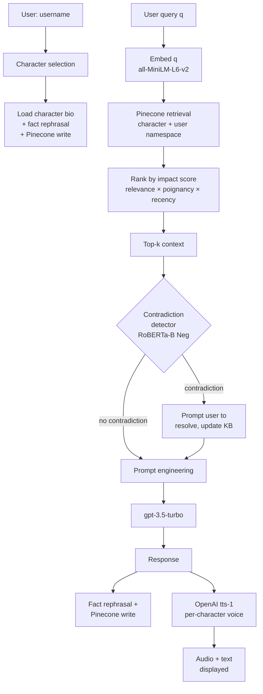

# ChatNPC

> A dialogue system that lets users hold conversations with fictional characters, where each character remembers what's been said — across sessions and across users. Built on retrieval-augmented generation with a custom impact-score retrieval metric, a fact-rephrasal pipeline, and a contradiction-detection module.

This is the codebase for my MSc thesis at **Saint Francis Xavier University** (Mathematics, Statistics and Computer Science, May 2024). Co-supervised by Dr. James Hughes and Dr. Milton King; committee member Dr. Jean-Alexis Delamer.

📄 **Thesis:** Heavey, E. (2024). *ChatNPC*. Master of Science thesis, St. Francis Xavier University.

## What it is

NPCs in modern games typically fall into one of two camps: scripted (consistent but rigid and forgettable) or LLM-driven (flexible but generic, hallucination-prone, and amnesiac). ChatNPC explores a middle path. Players interact with one of seven fictional characters set in the town of Ashbourne through a web interface. Each character:

- holds a per-character, per-user memory store via Pinecone vector database namespaces,
- retrieves the *most impactful* memories (not just the most cosine-similar ones) at inference time,
- checks new statements for contradictions against existing memories before responding,
- distills incoming sentences into atomic facts before storing them, so the memory is rephrasable and queryable.

A short example with the character Melinda Deek (knight of Ashbourne):

> **You:** What do you do?
>
> **Melinda:** I serve the village of Ashbourne as its knight, upholding the values of chivalry and protecting the people from threats such as bandits. My duties involve sword fighting and horsemanship, skills in which I have been trained since a young age. I reside in Redwood Manor, which is situated near the heart of Ashbourne.

## Four pillars of the system

**1. External memory via Pinecone.** Each character's facts (from a hand-written biography) and conversation history (queries and answers) are embedded with `all-MiniLM-L6-v2` and stored in a per-character namespace, partitioned by username. This means two users can build entirely separate relationships with the same character; their conversations don't bleed into each other.

**2. Fact rephrasal.** Before anything goes into the memory, GPT splits compound sentences into atomic facts. The sentence *"Caleb Brown is a friendly and hardworking baker who was born and raised in Quarlet"* becomes five separate records: *"Caleb Brown is friendly"*, *"Caleb Brown is hardworking"*, *"Caleb Brown is a baker"*, *"Caleb Brown was born in Quarlet"*, and *"Caleb Brown was raised in Quarlet"*. This atomicity is what makes downstream contradiction detection tractable — you can compare candidate statements against single propositions instead of paragraphs.

**3. Impact score retrieval.** Instead of ranking memories by cosine similarity alone, ChatNPC ranks by a three-factor *impact score* (inspired by Park et al. 2023, *Generative Agents*) that multiplies:

```
impact = relevance × poignancy × recency
```

- **relevance:** cosine similarity between the user's embedded query and each memory
- **poignancy:** a GPT-scored 1–10 importance rating for that memory relative to the character ("how much does this matter to Caleb the baker?"); computed at write time
- **recency:** exponential decay on time-since-last-accessed, with decay rate γ = 0.01 — so old, never-referenced memories fade

The top-*k* records by impact score become context for the response prompt. The thesis benchmarks this against pure cosine retrieval in Chapter 5.

**4. Contradiction detection.** Before responding, the system checks whether the user's query contradicts any of the retrieved memories using a fine-tuned NLI classifier. If it does, the user is prompted to resolve the conflict, and the memory store is updated accordingly. The NLI module itself is the subject of Chapter 4 and is described below.

## Architecture



## Contradiction detection: NLI experiments

The contradiction detector is a ternary NLI classifier (entailment / neutral / contradiction). The thesis evaluates seven vanilla architectures and several augmented variants across three standard NLI datasets.

### Vanilla model results

**SICK** (test, 4,927 records):

| Model | Accuracy | F1 |
|---|---|---|
| Li et al. 2017 baseline | 84.27% | — |
| BBU (bert-base-uncased) | 85.24% | 0.853 |
| RoBERTa-B | 88.90% | 0.889 |
| **RoBERTa-L** | **89.35%** | **0.893** |
| SVM-BBU | 79.62% | 0.796 |
| SVM-SBERT | 73.68% | 0.728 |
| XGBoost | 63.89% | 0.630 |

**SNLI** (test, 9,824 records, average of 30 runs):

| Model | Accuracy | F1 |
|---|---|---|
| EFL baseline (Wang et al. 2021) | 93.10% | — |
| BBU | 92.36% | 0.926 |
| **RoBERTa-B** | **94.27%** | **0.943** |
| RoBERTa-L | 93.73% | 0.938 |

**MultiNLI** (matched / mismatched test):

| Model | M.Test | Mm.Test |
|---|---|---|
| BERT+TDA (Wu et al. 2022) | **85.4%** | **85.9%** |
| BBU | 72.68% | 70.06% |
| RoBERTa-B | 80.36% | 80.22% |
| RoBERTa-L | 84.02% | 83.07% |

Vanilla RoBERTa beats both the Li et al. (SICK) and EFL (SNLI) baselines but doesn't reach the BERT+TDA MultiNLI baseline.

### Augmented architectures

Two augmentations were explored:

- **Negation count feature** — single integer appended to the embedding representation: total number of negation words across both input sentences.
- **Persistent homology (PH) vectors** — topological features extracted from `[CLS]` embeddings via the Ripser library, following Wu et al. 2022 (260 dimension-0 features, 50 dimension-1 features per sentence).

The honest findings:

- **Negation feature on RoBERTa was a small but consistent win** (+0.33% on M.Test, +0.04% SNLI, +0.11% SICK). Best augmented model: RoBERTa-B Neg.
- **Negation feature on BERT was a disaster.** BBU Neg lost 24.43% accuracy on Mm.Test — the classifier collapsed to predicting entailment for every record. The 768-dim `[CLS]` embedding may swamp a scalar negation signal.
- **Persistent homology underperformed across the board.** MLP-headed PH models hit ~14–29% accuracy on SICK; SVM heads doubled that but stayed below the vanilla baseline. The thesis hypothesises that the SICK training set (4,500 records) is too small for the MLP head, and that PH features may be interpreted as noise by the LLM backbone when fused naively. Combined Neg+PH models didn't recover the vanilla performance either.

### Final pick

The deployed contradiction detector is **RoBERTa-B + negation count feature**, chosen for its combination of accuracy across all three datasets and tractable training time.

## Information retrieval evaluation

Chapter 5 benchmarks four retrieval configurations (cosine vs impact score × with vs without fact rephrasal) on three test questions:

| Retrieval method | Fact rephrasal | Latency (s/token) | MB received/token |
|---|---|---|---|
| Cosine | No | 0.141 | 0.86 |
| Cosine | Yes | 0.318 | 1.08 |
| **Impact score** | **No** | **0.110** | 0.92 |
| Impact score | Yes | 0.389 | 2.57 |

The full **impact score + fact rephrasal** configuration is the slowest and most network-heavy — but it's the one shipped, because the alternatives produce noticeably lower-quality replies that drag in irrelevant context. Speed/quality trade-off explicitly chosen in favour of quality.

## LLM backend comparison

Five LLMs were qualitatively tested as the dialogue backbone using the prompt *"Briefly tell me about your favourite game"*:

| Model | Result | Verdict |
|---|---|---|
| GPT-J-6B | "I like playing games." | Too terse |
| Dolly-v1-6b | Continued the prompt then answered its own follow-up | Unstable |
| LLaMA 70B | Coherent refusal + offer to help | Strong, but 129 GB to host |
| GPT-4 | Comparable to GPT-3.5-Turbo | More expensive |
| **GPT-3.5-Turbo** | Coherent refusal + offer to help | Chosen — best speed/cost balance |

## The cast

Seven hand-written characters live in the fictional town of Ashbourne (full biographies in the thesis appendix): **John Pebble**, **Caleb Brown** (baker), **Peter Satoru**, **Melinda Deek** (knight), **Jack McCaster**, **Sarah Ratengen** (tavern keeper), and **Evelyn Stone Brown**. Each is paired with a distinct OpenAI `tts-1` voice (Alloy, Echo, Onyx, Shimmer, Fable, Nova) for audio replies.

## Datasets used

| Dataset | Train | Valid | Test |
|---|---|---|---|
| SICK | 4,500 | 500 | 4,927 |
| SNLI | 54,935 | 9,842 | 9,824 |
| MultiNLI (subset) | 11,893 | 9,711 (M+Mm) | 9,832 (M+Mm via Kaggle) |

Records with annotator-disagreement labels were removed during preprocessing.

## Setup

```bash
git clone https://github.com/VeiledTee/ChatNPC.git
cd ChatNPC
pip install -r requirements.txt
```

You'll need API keys for OpenAI (`gpt-3.5-turbo`, `tts-1`) and Pinecone. Copy `keys.py.example` to `keys.py` and fill in.

## Usage

Launch the web interface:

```bash
python webchat.py
```

Run a CLI conversation:

```bash
python chat.py --character "Melinda Deek" --backend gpt-3.5-turbo
```

Reproduce the NLI experiments:

```bash
python classification_bert.py     # vanilla BERT/RoBERTa classifiers
python ContradictDetectNN.py       # augmented architectures
python persitent_homology.py       # PH feature extraction
```

## Repository layout

```
.
├── Data/                # SICK, SNLI, MultiNLI splits (cleaned)
├── Figures/             # thesis figures
├── Models/              # trained NLI checkpoints
├── Prompts/             # prompt templates per character / scenario
├── Text Summaries/      # character biographies, town lore
├── WebBot/              # browser UI assets
├── Memory.py            # Pinecone wrapper + impact-score retrieval
├── retrieval.py         # impact score = relevance × poignancy × recency
├── ContradictDetectNN.py # augmented NLI architectures
├── BiLSTM.py / RoBERTaBASENeg.py / classification_*.py  # NLI variants
├── persitent_homology.py # Ripser-based PH feature extraction
├── gpt4.py / gptj.py / dolly.py / llama_script.py       # LLM backends
├── chat.py / webchat.py # CLI and web interfaces
└── LIGHT_test.py        # evaluation on Facebook AI's LIGHT dataset
```

## Citation

```bibtex
@mastersthesis{heavey-2024-chatnpc,
    author  = {Heavey, Ethan},
    title   = {{ChatNPC}},
    school  = {St. Francis Xavier University},
    address = {Antigonish, Nova Scotia, Canada},
    year    = {2024},
    month   = may,
    type    = {Master of Science in Computer Science thesis},
    url     = {https://hdl.handle.net/20.500.14648/3302},
    note    = {stfxir:3947},
}
```

## Acknowledgements

Co-supervisors Dr. James Hughes and Dr. Milton King; committee member Dr. Jean-Alexis Delamer; the StFX Department of Mathematics, Statistics and Computer Science.
